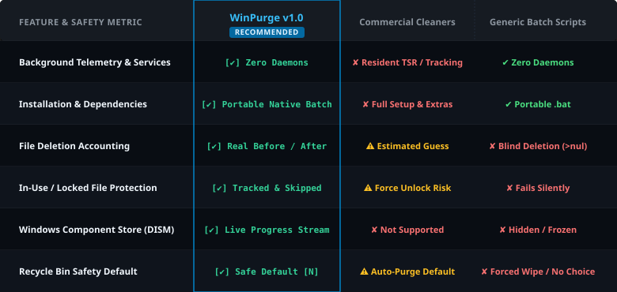
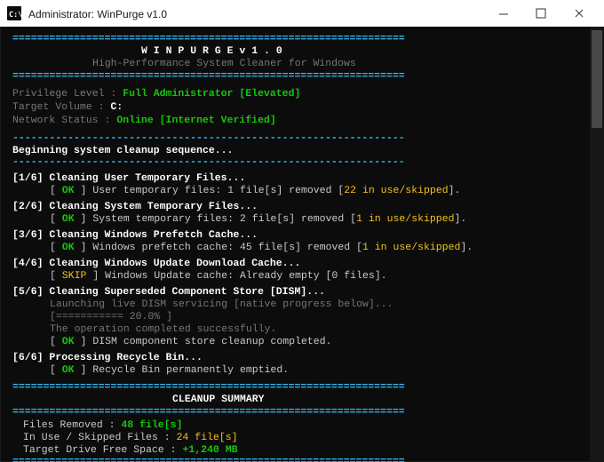
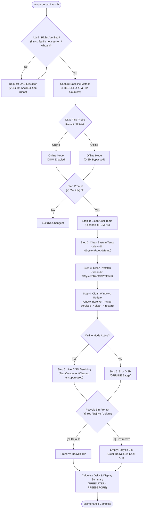
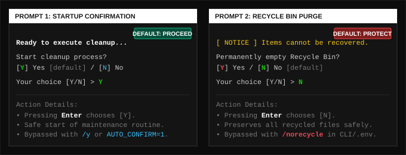
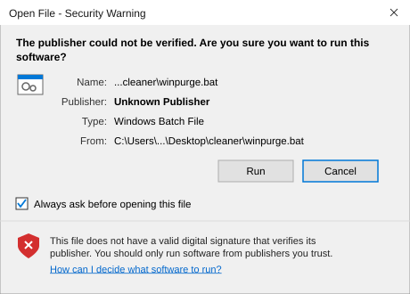
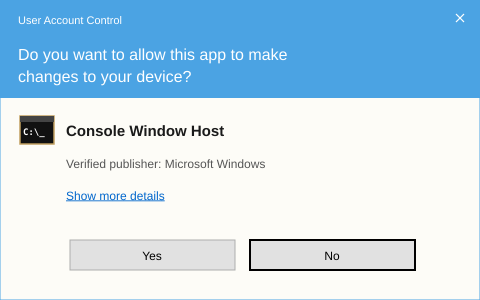

# WinPurge

> High-performance, zero-telemetry system cleaner for Windows 10 and 11. Built entirely with native Windows Batch, requiring zero external dependencies, no compilers, and no background daemons.

[](LICENSE)
[](https://microsoft.com/windows)
[](#architecture)
[](winpurge.bat)

---

## Table of Contents
1. [Overview](#overview)
2. [Why WinPurge is Better](#why-winpurge-is-better)
3. [Interface &amp; Execution Preview](#interface--execution-preview)
4. [Architecture &amp; Execution Pipeline](#architecture--execution-pipeline)
5. [Core Cleaning Operations &amp; Real Metrics](#core-cleaning-operations--real-metrics)
6. [Interactive Prompts &amp; Decision Safety](#interactive-prompts--decision-safety)
7. [Network Detection &amp; Offline Safety](#network-detection--offline-safety)
8. [First-Run Security &amp; Privilege Verification](#first-run-security--privilege-verification)
9. [Common Errors &amp; Troubleshooting Guide](#common-errors--troubleshooting-guide)
10. [Command-Line Reference](#command-line-reference)
11. [Environment Configuration (.env)](#environment-configuration-env)
12. [Threat Model &amp; Transparency](#threat-model--transparency)
13. [License](#license)

---

## Overview

WinPurge is a standalone Windows maintenance utility engineered to safely reclaim gigabytes of disk space consumed by orphaned temporary directories, bloated Windows Update component stores, and stale application caches.

It is delivered as a **single, self-contained batch file (`winpurge.bat`)**. Unlike commercial cleaners that install background services or send telemetry, WinPurge operates strictly via documented Windows utilities (`fltmc`, `dism.exe`, `net.exe`). Every line of code is human-readable and auditable in plain text.

---

## Why WinPurge is Better

Most commercial cleaning tools bundle background telemetry daemons, persistent startup services, and aggressive registry cleaners that risk breaking Windows subsystem bindings. Conversely, basic cleanup batch scripts run blind deletions redirected to null (`>nul 2>&1`), providing zero verifiable telemetry and crashing when files are locked by running software.

WinPurge bridges this gap: zero installation footprint, transparent execution, active locked-file accounting, and protective default prompts.

<p align="center">
  
</p>

---

## Interface &amp; Execution Preview

WinPurge features a high-contrast console layout with clean ANSI color coding (Red, Green, White, Cyan, Yellow) and standard bracketed indicators (`[  OK  ]`, `[ SKIP ]`, `[ OFFLINE ]`) designed to render without raw escape artifacts across all Windows consoles.

<p align="center">
  
</p>

---

## Architecture &amp; Execution Pipeline

The flowchart below illustrates WinPurge's end-to-end execution flow, UAC self-elevation trampoline, network connectivity probe, and sequential 6-step cleaning pipeline:



---

## Core Cleaning Operations &amp; Real Metrics

WinPurge executes a sequential, 6-step deep cleaning routine targeting safe, non-essential caches across the operating system.

Unlike naive scripts that report success blindly, WinPurge uses an active before-and-after counting engine (`:cleandir`) that measures file counts beforehand, tracks files locked by open applications, and measures total drive space reclaimed down to the megabyte.

| Step | Operation Target | Filesystem / Service Path | Metrics &amp; Safety |
|:---:|:---|:---|:---|
| **1** | **User Temporary Files** | `%TEMP%\*` | Counts files before/after deletion. Reports exact deleted count and tracks active files held by open apps. |
| **2** | **System Temporary Files** | `%SystemRoot%\Temp\*` | Cleans root-level Windows staging folders, installer scratch spaces, and dump files with locked-file accounting. |
| **3** | **Windows Prefetch Cache** | `%SystemRoot%\Prefetch\*` | Flushes stale execution hashes. Skipped gracefully if configured or empty. |
| **4** | **Windows Update Cache** | `%SystemRoot%\SoftwareDistribution\Download\*` | Verifies `TiWorker.exe` is idle, pauses `wuauserv` &amp; `bits`, deletes downloaded payloads, and restarts services. |
| **5** | **DISM Component Store** | `dism.exe /Online /Cleanup-Image /StartComponentCleanup` | Displays live native DISM progress streaming directly to console. Automatically bypassed if offline. |
| **6** | **Recycle Bin** | System Shell API | Empties the system drive's recycle bin after explicit confirmation via Windows Shell API. |

### End-of-Run Performance Summary

At the conclusion of the maintenance routine, WinPurge displays an exact performance summary box:
- **Files Removed:** Total count of purged files across all temporary directories.
- **In Use / Skipped Files:** Exact tally of files safely skipped due to active file locks by running software.
- **Target Drive Free Space:** Net disk space freed on drive `C:`, calculated in real megabytes.

---

## Interactive Prompts &amp; Decision Safety

To prevent accidental data destruction, WinPurge incorporates two distinct interactive confirmation prompts with strict safety defaults.

<p align="center">
  
</p>

### Prompt 1: Initial Execution Confirmation
```text
Start cleanup process? [Y] Yes [default] / [N] No
Your choice [Y/N] >
```
- **Default Choice:** `[Y]` (Proceed in Green). Commences standard cleaning.
- **Cancel Choice:** `[N]`. Halts script execution immediately without altering the filesystem.
- **Bypass:** Pass `/y` on the command line or set `AUTO_CONFIRM=1` in `.env`.

### Prompt 2: Recycle Bin Destruction Warning
```text
[ NOTICE ] Items currently inside the Recycle Bin cannot be recovered.
Permanently empty Recycle Bin? [Y] Yes / [N] No [default]
Your choice [Y/N] >
```
- **Default Choice:** `[N]` (Protective Default in Green). Preserves all deleted files.
- **Destructive Choice:** `[Y]` (Highlighted in Red). Empties `$Recycle.bin`.
- **Permanent Bypass:** Pass `/norecycle` on the command line or set `SKIP_RECYCLE_BIN=1` in `.env`.

---

## Network Detection &amp; Offline Safety

Before initiating maintenance, WinPurge runs a rapid 1-second network connectivity check via DNS ping.

- **Online Mode:** When connected to the internet, all 6 steps execute normally, including live DISM component servicing.
- **Offline Mode:** If no active internet connection is detected:
  - Displays a prominent red warning: `[ OFFLINE ] No active internet connection detected.`
  - Automatically skips Step 5 (DISM) with a warning badge: `[ OFFLINE ] Bypassed: Component store cleanup skipped [no internet connection].`
  - Continues safely executing all local cleaning operations (User Temp, System Temp, Prefetch, Recycle Bin) without network timeouts or hang delays.

---

## First-Run Security &amp; Privilege Verification

Because WinPurge is distributed as an unsigned, open-source script rather than a commercial executable bearing an expensive digital code-signing certificate, Windows security features may prompt for user consent upon initial execution.

### 1. Windows Open File Security Warning (Mark-of-the-Web)
When downloading `winpurge.bat` via a web browser, Windows marks the file with a Mark-of-the-Web (`Zone.Identifier`) alternate data stream, prompting an Open File security warning:

<p align="center">
  
</p>

**How to Proceed:**
1. Click **Run** on the dialog.
2. If Windows Defender SmartScreen appears, click **More info** followed by **Run anyway**.

---

### 2. User Account Control (UAC) Elevation
Cleaning system temporary files, manipulating Windows Update background services (`wuauserv`, `bits`), and running DISM component cleanup require verified local administrator rights.

<p align="center">
  
</p>

WinPurge includes an internal elevation trampoline using VBScript `Shell.Application` `runas` targeting `conhost.exe`. When double-clicked under standard user privileges, WinPurge requests administrative elevation automatically. Click **Yes** on the UAC prompt to proceed.

---

## Common Errors &amp; Troubleshooting Guide

### 1. File Blocked by Windows Mark-of-the-Web
- **Symptom:** Windows displays `Open File - Security Warning` or `Windows protected your PC` every time the script is launched.
- **Root Cause:** Web browsers attach a zone transfer flag to downloaded files.
- **Resolution (PowerShell):** Unblock the file using PowerShell:
  ```powershell
  Unblock-File -Path .\winpurge.bat
  ```
- **Resolution (File Explorer):** Right-click `winpurge.bat` > **Properties** > Check **Unblock** at the bottom > Click **Apply**.

---

### 2. Administrator Privilege Acquisition Rejection
- **Symptom:** Script displays `[ ERROR ] Administrator privileges could not be acquired.`
- **Root Cause:** The user clicked `No` on the UAC elevation prompt, or Windows policy forbids elevation for the current account.
- **Resolution:** Right-click `winpurge.bat` and select **Run as administrator**, or launch from an already elevated Command Prompt.

---

### 3. Active Files In-Use / Skipped
- **Symptom:** Step 1 or Step 2 reports `[ OK ] User temporary files: 0 file[s] removed [22 in use/skipped]`.
- **Root Cause:** Active applications (Google Chrome, Discord, Microsoft Office, Windows Explorer) maintain exclusive read/write handles on active scratch files.
- **Resolution:** This is intentional protection. WinPurge intentionally skips locked files rather than forcibly terminating processes or corrupting open session caches. To purge these files, close active applications before running WinPurge.

---

### 4. DISM Jumps Directly from 20% to "Completed Successfully"
- **Symptom:** Step 5 displays `[=========== 20.0% ] The operation completed successfully.` without advancing to 100%.
- **Root Cause:** When `dism.exe /Online /Cleanup-Image /StartComponentCleanup` runs, it scans for superseded update components. If a previous cleanup already purged superseded packages, DISM concludes that no packages need tombstoning and exits successfully.
- **Resolution:** Normal Windows servicing behavior. No action required.

---

### 5. Windows Update Cache Skipped (TiWorker Active)
- **Symptom:** Step 4 displays `[ SKIP ] Windows Update cache: Skipped [Windows Update is actively installing].`
- **Root Cause:** The Windows Trusted Installer service (`TiWorker.exe`) is actively applying an operating system update in the background.
- **Resolution:** WinPurge detects active Windows servicing and safely bypasses cache purging to prevent corrupting the active update transaction. Allow Windows Update to finish installing before re-running WinPurge.

---

## Command-Line Reference

WinPurge accepts optional flags to tailor execution for scheduled tasks, batch scripts, or customized environments:

```cmd
winpurge.bat [/y] [/norecycle] [/noprefetch] [/nocolor]
```

### Argument Details

| Flag | Long Flag | Description |
|:---|:---|:---|
| `/y` | `/yes` | Automatically answers **Yes** to the initial confirmation prompt. Useful for automated deployments. |
| `/norecycle` | -- | Completely skips Step 6 (Recycle Bin purge), ensuring no files in the Recycle Bin are removed. |
| `/noprefetch` | -- | Skips Step 3 (Prefetch flush), preserving Windows application launch indexing. |
| `/nocolor` | -- | Disables ANSI color sequences, producing plain monochrome output. |

### Example Invocations

```cmd
:: Run standard interactive clean
winpurge.bat

:: Run unattended clean with Recycle Bin preserved
winpurge.bat /y /norecycle

:: Run automated enterprise maintenance routine
winpurge.bat /y /norecycle /noprefetch /nocolor
```

---

## Environment Configuration (.env)

WinPurge natively parses an optional `.env` file located in the same directory as `winpurge.bat`. This enables power users and system administrators to enforce custom policies without editing the batch code.

A template is provided in [`.env.example`](.env.example):

```ini
# WinPurge v1.0 Configuration Template
# Copy this file to .env in the same folder as winpurge.bat

# Set to 1 to automatically confirm the initial start prompt
AUTO_CONFIRM=0

# Set to 1 to permanently skip emptying the Recycle Bin
SKIP_RECYCLE_BIN=0

# Set to 1 to skip flushing the Windows Prefetch cache
SKIP_PREFETCH=0

# Set to 1 to disable ANSI color formatting
NO_COLOR=0
```

---

## Threat Model &amp; Transparency

| Assurance | Implementation Details |
|:---|:---|
| **Zero Network Calls** | The network check uses a standard DNS echo ping (1.1.1.1 / 8.8.8.8). No HTTP/HTTPS calls or data transmission occurs. |
| **No In-Memory Injections** | WinPurge avoids in-memory PowerShell `Invoke-Expression` tricks, completely eliminating heuristic anti-virus alerts (e.g. `Trojan:Win32/Commando.C!ml`). |
| **No Registry Tampering** | WinPurge does not alter arbitrary system registry hives, disable security policies, or modify Windows defender configurations. |
| **Non-Destructive Defaults** | All destructive options default to cancel or require explicit user confirmation. |

---

## License

This project is licensed under the [MIT License](LICENSE).
